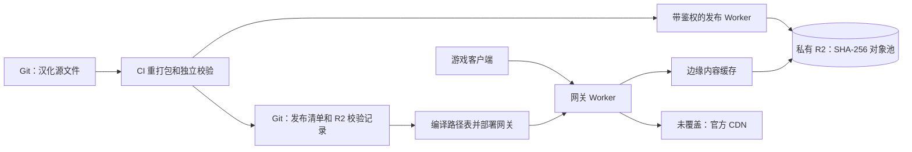

# Cloudflare assets 网关（私有 R2 源站）

线上地址：[mltd-asset-cf.nyaneko.cn](https://mltd-asset-cf.nyaneko.cn)。
Worker 绑定私有 bucket `mltd-localized-assets`，按编译进部署的路径表读取汉化文件。
没覆盖的文件、其他游戏资源版本、R2 读取失败均转发官方 CDN。



## 发布与跨版本复用

1. 从 R2 恢复保留版本的对象和解析缓存；构建阶段仍使用本地 `generated/` 工作目录。
   恢复通过每批最多 32 个对象、4 MiB 的带鉴权只读传输减少 HTTPS 往返，客户端仍逐对象验证 SHA-256。
   大于 4 MiB 的对象独立流式传输，限制发布 Worker 的内存占用。
2. 复用已经验证兼容的文字与图片成果，并合入新增的、独立审计通过的图片覆盖包。
3. 本地验证每个文件的 SHA-256；仅上传 R2 缺少的对象，R2 再校验上传流的 SHA-256。
4. 所有引用上传成功后，写 `generated/r2-storage.json`，包含对象大小、解析缓存地址和旧覆盖包对应关系。
5. 使用既有主分支输入检查和普通 Git push 的并发保护发布清单。输入变化则重新排队构建。
6. 统一生产入口在同一次运行中调用 `cloudflare-gateway.yml`，编译最新清单、部署路径表，再进行真实网络逐字节抽样验收。

R2 中每个文件位于 `objects/sha256/<digest>`；不同版本、文字和图片共用一个对象池。
逻辑名和游戏版本保存在清单里。字节相同只存一份；字节不同不能仅凭“文字看起来一样”复用整个 Bundle。
图片复用继续要求当前官方源文件 SHA-256 与已发布成果绑定的源 SHA-256 相同。

解析缓存位于 `build-cache/sha256/<archive-digest>`，包含按解析器指纹和官方源 SHA-256 区分的缓存。
缓存归档具有稳定头部；内容不变时不会重复上传。

R2 发布最多保留数值最大的两个资源版本（`retain_releases=2`），按两份清单的 SHA-256 引用并集保留对象。
第三个版本上线后，删除更旧版本独有的对象，共用对象保留。Git 源文件、PNG、歌词、文字及历史发布清单不受限制。
仅保留当前解析缓存归档；审计覆盖包按保留版本保留。所有 R2 写入和 GC 共用 CI 串行锁，
只有网关部署与逐字节线上验收通过、main 未变化时才执行 `prune --apply`。上传失败或部署失败不会提前删线上文件。
清理前再次验证所有保留对象均存在；删除后重新列举验证。独立运行 `prune` 默认只显示计划。

```bash
python scripts/r2_release_storage.py prune       # 预览，无删除
# CI 在 r2-mutation 锁内、网关验收通过后执行：
python scripts/r2_release_storage.py prune --apply
```

Git 只保留源文件、发布清单、校验和、R2 校验记录及代码，不再追踪重打包 Bundle、对象池和解析缓存。
历史 Git 提交中的旧二进制仍保留；本次没有重写历史。全新克隆建议使用 `--filter=blob:none`。

迁移时保留的 1077741 / 1077750 分别引用 641.42 / 643.99 MiB；共享 11,060 个对象、584.22 MiB。
去重后合计 12,317 个对象、701.19 MiB，比分别存储节约约 45.5%。解析缓存归档另占约 53.89 MiB。

## R2 Class B 优化：小文件包

网关在保留每个原始文件的对象存储地址和客户端 URL 的同时，把小于等于
256 KiB 的已 SHA-256 校验对象组合成不超过 1 MiB 的不可变包，存放于
packs/sha256/<pack-digest>。Git 发布清单写入每个原对象的包偏移、包哈希与包
大小，Worker 部署表携带经过清单核对的映射。

客户端仍按原 URL 请求、使用原文件 SHA-256 作为 ETag，支持 HEAD、单段 Range、
If-Range 和 If-None-Match。多个小文件命中同一个已缓存包时不需要分别读取 R2，
同一 isolate 内同时访问一个冷包的请求也会合并成一次 GET。首次读取时对整个包
再次核验 SHA-256，CI 恢复时额外按各原文件 SHA-256 验证切片。

保留原对象作为故障降级：包缺失/损坏时会先使用原来按对象读取的路径，
再由既有逻辑回落官方 CDN。发布顺序为先逐对象上传/校验，再上传 pack 并确认，
最后写元数据和部署；GC 只在网关验收通过后运行，并保留当前被引用的 pack。
老版本的无包清单继续使用单文件读取，兼容回滚。

未被打包且不超过 2 MiB 的资源若首次接到单段 Range 请求，则缓存整份
不可变对象，后续其他 Range 请求直接从边缘缓存切片（命中时不触发 R2 GET）。
大于 2 MiB 的资源始终按请求的 Range 流式读取，避免小范围读取导致大量
不必要的下载、内存和延迟。原 ETag、If-Range、206/416、Range 字节位置
与失败回退语义不变。

这些改动通过增加极少量 Class A 写操作和最多约 96 MiB 附加存储，换取
大量小文件首次读取 R2 时更少的 Class B 次数。实际效果取决于 Cloudflare
数据中心的缓存命中率、缓存逐出、并发、流量模式，不保证按理论比例降低账单。

## 缓存与更新时效

| 路径/层 | 策略 | 更新行为 |
| --- | --- | --- |
| 网关内部内容对象 | Cache API，`public, max-age=31536000, immutable`；键为 bucket + SHA-256 | 相同字节跨版本、跨部署复用；新内容使用新键，不覆盖旧键 |
| 面向客户端的稳定 URL | `public, max-age=0, must-revalidate`，强 ETag 为 SHA-256 | HTTP 缓存每次验证；没变返回 304，无需读取 R2；部署新表后变更内容立即采用新哈希 |
| Range | 直接从 R2 读指定范围，不缓存部分内容 | 支持单段、后缀、If-Range；越界返回 416 |
| 官方回落、上传 API 错误 | 不写入内容对象缓存 | 不会把错误或日文文件长期缓存为某个汉化哈希 |

更新需要上传、提交清单和部署完成；不是“文件上传完即切换”。Worker 部署有短暂传播时间。
不需要 purge 或等待一年的 TTL。Cache API 按数据中心缓存，可能被驱逐，驱逐后重新读取 R2。
游戏自己的本地资源缓存不受 HTTP 头控制；同版本已下载资源是否重取取决于客户端。

## 凭据与运行

bucket 不开启公开访问。公开网关只提供 GET/HEAD，没有写入路由。
独立发布 Worker `mltd-localized-publisher` 需要 Bearer token，且仅允许不可变哈希键的读取、校验写入和清单查询，
没有任意路径写入、覆盖或删除功能。上传身份只访问这个 bucket。

CI secrets：`CLOUDFLARE_API_TOKEN` 部署 Worker，`R2_PUBLISH_TOKEN` 访问发布 Worker。
发布 Worker 中对应的 secret 名称为 `PUBLISH_TOKEN`。令牌不写入仓库或 URL。
发布 URL 和 bucket 配置在 `configs/r2-storage.json`。

```bash
python scripts/r2_release_storage.py restore
python scripts/build_generated_release.py --reuse-published-images
python scripts/r2_release_storage.py publish
# 使用正常的元数据发布流程后：
python asset-server/cloudflare/build_index.py --apply
cd asset-server/cloudflare && npx --yes wrangler@4 deploy
```

网关部署仅需 Git 元数据，不必下载全部对象。线上验收从 R2 恢复固定种子的样本和资源索引：

```bash
python scripts/r2_release_storage.py restore --no-cache --samples 3
python asset-server/cloudflare/check_gateway.py --base https://mltd-asset-cf.nyaneko.cn --samples 3
node asset-server/cloudflare/test_newest_version_fallback.mjs
node asset-server/r2-publisher/test_publisher.mjs
```

`/healthz` 报告版本、清单提交和 `object_store: r2`。
响应头：`x-mltd-object-store: r2`、`x-mltd-cache: hit/miss/bypass/index`、`x-mltd-build`。
R2 读取失败使用 `x-mltd-asset-source: official-r2-unavailable`。
显式请求其他版本不会拿当前版本汉化包替代。无版本的官方 4xx 恢复规则保持不变：
第三方版本 feed 最多缓存 15 分钟，仅成功取得新版官方文件时采用它。

## R2 实际消耗与 Gateway 缓存观测

Bucket 级 R2 Data Access Logs 的启用步骤、Workers 5% 采样日志、
实际 GET 与 HTTP 请求的区别、导出日志安全汇总方式见
[docs/R2_OBSERVABILITY.md](../../docs/R2_OBSERVABILITY.md)。
