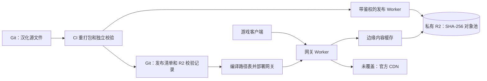

# Cloudflare assets 网关（私有 R2 源站）

线上地址：[mltd-asset-cf.nyaneko.cn](https://mltd-asset-cf.nyaneko.cn)。
Worker 绑定私有 bucket `mltd-localized-assets`，按编译进部署的路径表读取汉化文件。
没覆盖的文件、其他游戏资源版本、R2 读取失败均转发官方 CDN。
NAS 不参与这条发布或分发链路。



## 发布与跨版本复用

1. 从 R2 恢复保留版本的对象和解析缓存；构建阶段仍使用本地 `generated/` 工作目录。
   恢复通过每批最多 32 个对象、4 MiB 的带鉴权只读传输减少 HTTPS 往返，客户端仍逐对象验证 SHA-256。
   大于 4 MiB 的对象独立流式传输，限制发布 Worker 的内存占用。
2. 复用已经验证兼容的文字与图片成果；图片生成目前暂停，图片发布开启。
3. 本地验证每个文件的 SHA-256；仅上传 R2 缺少的对象，R2 再校验上传流的 SHA-256。
4. 所有引用上传成功后，写 `generated/r2-storage.json`，包含对象大小、解析缓存地址和旧覆盖包对应关系。
5. 使用既有主分支输入检查和普通 Git push 的并发保护发布清单。输入变化则重新排队构建。
6. 统一生产入口在同一次运行中调用 `cloudflare-gateway.yml`，编译最新清单、部署路径表，再进行真实网络逐字节抽样验收。

R2 中每个文件位于 `objects/sha256/<digest>`；不同版本、文字和图片共用一个对象池。
逻辑名和游戏版本保存在清单里。字节相同只存一份；字节不同不能仅凭“文字看起来一样”复用整个 Bundle。
图片复用继续要求当前官方源文件 SHA-256 与已发布成果绑定的源 SHA-256 相同。

解析缓存位于 `build-cache/sha256/<archive-digest>`，包含按解析器指纹和官方源 SHA-256 区分的缓存。
缓存归档具有稳定头部；内容不变时不会重复上传。新归档可能保留旧归档，暂不自动清理 R2：
GC 需要先检查所有保留清单及仍可能运行的网关部署，不能按资源版本直接删除共享对象。

Git 只保留源文件、发布清单、校验和、R2 校验记录及代码，不再追踪重打包 Bundle、对象池和解析缓存。
历史 Git 提交中的旧二进制仍保留；本次没有重写历史。全新克隆建议使用 `--filter=blob:none`。

迁移时保留的 1077741 / 1077750 分别引用 641.42 / 643.99 MiB；共享 11,060 个对象、584.22 MiB。
去重后合计 12,317 个对象、701.19 MiB，比分别存储节约约 45.5%。解析缓存归档另占约 53.89 MiB。

## 缓存与更新时效

| 路径/层 | 策略 | 更新行为 |
| --- | --- | --- |
| 网关内部内容对象 | Cache API，`public, max-age=31536000, immutable`；键为 bucket + SHA-256 | 相同字节跨版本、跨部署复用；新内容使用新键，不覆盖旧键 |
| 面向客户端的稳定 URL | `public, max-age=0, must-revalidate`，强 ETag 为 SHA-256 | HTTP 缓存每次验证；没变返回 304，无需读取 R2；部署新表后变更内容立即采用新哈希 |
| Range | 直接从 R2 读指定范围，不缓存部分内容 | 支持单段、后缀、If-Range；越界返回 416 |
| 官方回落、上传 API 错误 | 不写入内容对象缓存 | 不会把错误或日文文件长期缓存为某个汉化哈希 |

更新需要上传、提交清单和部署完成；不是“文件上传完即切换”。Worker 部署有短暂传播时间。
不需要 purge 或等待一年的 TTL。Cache API 按数据中心缓存，可能被驱逐，驱逐后重新读取 R2。
游戏自己的本地资源缓存不受 HTTP 头控制；同版本已下载资源是否重取取决于客户端。

## 凭据与运行

bucket 不开启公开访问。公开网关只提供 GET/HEAD，没有写入路由。
独立发布 Worker `mltd-localized-publisher` 需要 Bearer token，且仅允许不可变哈希键的读取、校验写入和清单查询，
没有任意路径写入、覆盖或删除功能。上传身份只访问这个 bucket。

CI secrets：`CLOUDFLARE_API_TOKEN` 部署 Worker，`R2_PUBLISH_TOKEN` 访问发布 Worker。
发布 Worker 中对应的 secret 名称为 `PUBLISH_TOKEN`。令牌不写入仓库或 URL。
发布 URL 和 bucket 配置在 `configs/r2-storage.json`。

```bash
python scripts/r2_release_storage.py restore
python scripts/build_generated_release.py --reuse-published-images
python scripts/r2_release_storage.py publish
# 使用正常的元数据发布流程后：
python asset-server/cloudflare/build_index.py --apply
cd asset-server/cloudflare && npx --yes wrangler@4 deploy
```

网关部署仅需 Git 元数据，不必下载全部对象。线上验收从 R2 恢复固定种子的样本和资源索引：

```bash
python scripts/r2_release_storage.py restore --no-cache --samples 3
python asset-server/cloudflare/check_gateway.py --base https://mltd-asset-cf.nyaneko.cn --samples 3
node asset-server/cloudflare/test_newest_version_fallback.mjs
node asset-server/r2-publisher/test_publisher.mjs
```

`/healthz` 报告版本、清单提交和 `object_store: r2`。
响应头：`x-mltd-object-store: r2`、`x-mltd-cache: hit/miss/bypass/index`、`x-mltd-build`。
R2 读取失败使用 `x-mltd-asset-source: official-r2-unavailable`。
显式请求其他版本不会拿当前版本汉化包替代。无版本的官方 4xx 恢复规则保持不变：
第三方版本 feed 最多缓存 15 分钟，仅成功取得新版官方文件时采用它。
