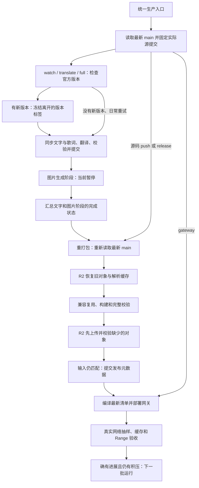

# CI 运行机制（R2 迁移后的统一入口）

日常入口由原来的分段派发收敛为三个；工作阶段使用 `workflow_call`，在同一次 production run 内展示。
保留生产入口文件名 `auto-track-jp-assets.yml`，现有 VPS `mltd-asset-watch.timer` 不需要改派发目标。
没有新增 GitHub schedule。NAS 不参与发布。

| 入口 | 触发与作用 |
| --- | --- |
| `validate-localization.yml` | 主分支 push、PR、手动；校验真实汉化数据，离线回归和全部 workflow 语法 |
| `auto-track-jp-assets.yml` | 唯一生产入口；VPS 检查/每日兜底、主分支源码 push、手动分阶段补跑 |
| `image-model-smoke.yml` | 仅显式手动试模型并保留对照图；不会发布资源，不受日常生产入口连带触发 |

`workflow-patch.yml` 已合并删除。`llm-translate-assets.yml`、`assets-generated.yml`、
`cloudflare-gateway.yml`、`image-localize-assets.yml` 是内部阶段，没有独立 Run workflow 按钮、push 或定时触发。
常规阶段衔接不再依赖 bot push 事件或 `workflow_run`，也不需要轮询其他 workflow 的运行状态。

## 生产运行的阶段图

图片生成关闭时，其 job 会跳过，ready 条件明确允许它跳过；发布仍校验并复用旧图片 Bundle。
图片生成将来开启时，启用阶段未完成或独立审核失败都不能发布部分成果。

## 手动模式和 push

| `stage` | 执行范围 |
| --- | --- |
| `watch`（默认） | 检查版本；有新版或 `daily_housekeeping=true` 才推进翻译和发布 |
| `translate` | 先检查/冻结版本，再做有界的翻译批次，产生有效提交后发布 |
| `release` | 不调用翻译服务，使用当前已有汉化成果构建和发布；这也是源码 push 的模式 |
| `gateway` | 只部署当前已发布清单并验收，用于修复分发端 |
| `full` | 检查、翻译、重打包和网关部署按依赖依次执行；检查/审核失败会阻断发布 |

`force_build=true` 强制重建 Bundle，跳过构建 gate 和逐 Bundle 复用；仍复用已经校验兼容的图片成果。
它不会恢复图片生成。`max_items` 非零是单批冒烟上限；默认 0 每批最多 500 条，剩余工作分批继续。
`publish_drafts=false` 保留机器草稿待审核；不会把草稿标成已审核来绕过发布规则。

源码 push 不调用模型。release gate 证明输入相同就跳过依赖安装、R2 恢复、构建和上传。
网关只在真正推送了发布元数据，或分发代码/发布清单变化、显式 `gateway/full` 时部署。
没有变化不会仅因测试或文档修改重复上传对象。

## 提交与版本的一致性

- plan 读取最新 main 后记录实际 `git rev-parse HEAD`。检查与冻结都 checkout 这个固定提交，冻结前再次核对。
- `assets-<version>` 标签不可变；已存在时只有其提交记录的版本正确才能沿用。网络错误和不可读报告都失败，不能伪装成“无更新”。
- 翻译准备阶段固定源提交，通过带 SHA-256 的 exact-run Actions Cache 传给受限 runner；草稿 job checkout 同一提交并核对归档身份。
- 版本更新传入 `--expected-latest-version`。若官方在检查/冻结和准备阶段之间又变版，先失败重试，不越过冻结边界改源。
- 翻译会产生新的 Git 提交，因此后续构建和部署必须重新 checkout `main`，不能误用继承的入口 `github.sha`。
- R2 上传完成后才写校验记录。发布脚本 fetch 最新 main、比较影响产物的输入并普通 push；竞争中输入变化会排队新的 `release`，不部署陈旧结果。
- 上传内容以哈希为键且禁止覆盖、删除；失败或过时构建遗留的对象不会改变线上清单。

## runner、并发和失败

| 阶段 | runner 与时限 |
| --- | --- |
| plan、summary、积压续跑 | hosted Ubuntu，各 5 分钟 |
| 官方版本检查、冻结 | RackNerd 轻量 runner，各 15 分钟 |
| 文字同步准备 | hosted Ubuntu，180 分钟；官方 Bundle 留在大磁盘端 |
| 文字模型调用与提交 | RackNerd，180 分钟；通过 exact-run cache 接收有界文本与索引 |
| 图片生成（暂停） | RackNerd，350 分钟；保存进度、审计，单独速率限制 |
| 资源构建与 R2 上传 | hosted Ubuntu，45 分钟 |
| Worker 部署及线上验收 | hosted Ubuntu，30 分钟；只下载样本与目录索引 |
| 质量校验 / 回归 | 主分支 RackNerd；PR hosted Ubuntu；10 / 20 分钟 |

父运行按入口阶段分组排队，不取消正在写入的任务。翻译、图片、构建、网关各自保留独立写者锁，
父子不使用同名 concurrency group，避免相互等待。复用 job 自身不占用等待 runner，不会把唯一 RackNerd 插槽占住来等子任务。
PR 回归四 workers，主分支一个 worker，遵循 RackNerd 的 CPU/内存限制。

真实数据校验和离线 fixture 回归分开；actionlint 检查全部工作流输入、调用、表达式与自定义 runner 标签。
模型部分失败时先保存并校验已经成功的草稿，保留诊断；严重服务故障仍报告失败。
失败阶段不会被最后的 summary 覆盖成成功。summary 始终记录各阶段结果，方便在同一次 run 排障。

普通阶段没有派发链。只有两种有界续跑需要新的 run：发布输入已过期的 `release` 重试，
以及“有剩余条目且本批确实更新了行”的下一批翻译。零进展、失败、显式冒烟上限都不会自动循环。

R2 的对象布局、缓存 TTL、客户端 ETag、凭据边界和回滚条件见 [网关说明](../asset-server/cloudflare/README.md)。
