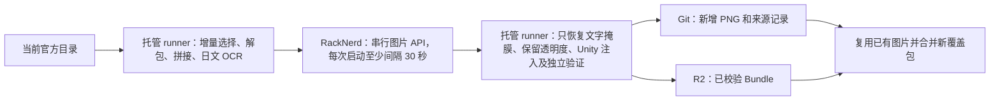

# 图片增量汉化

生产入口 `auto-track-jp-assets.yml` 的 `stage=images` 可以独立补图片积压；
日常 `translate/full` 也调用同一图片阶段。配置为 `gemini-3.1-flash-image`、串行、RPM 2。
直接请求模型名，使用 Gemini 原生 `/v1beta/models/gemini-3.1-flash-image:generateContent` 接口，
不经过 `imas-trans-image` 别名，也不走 OpenAI `/v1/images/edits`。
提交前按模型支持的画布比例补白，校验返回比例后去除补白，原图不拉伸，也不替换模型。
不再执行只有 937 张固定基线的旧批处理入口，已有 937 张汉化 PNG 和对应发布成果继续保留。

2026-10-15，1077750 目录中登记的八类图片合计 4,574 个 Bundle；现有发布覆盖其中 230 个，
另有 4,344 个待增量检查。漫画 968、单格漫画 415、白板 629、贴图 207；
另有活动横幅、教程、服装销售图、标题/Logo。这是 Bundle 数量，不能直接当作未翻译图片张数。
同一个 Bundle 可以含多张 Texture2D，OCR 未发现日文也不等于已经人工证明没有日文。

每批默认选择 12 个 Bundle，优先最新漫画。六段漫画按纹理名称的数字顺序拼接，
保留每段坐标；其他登记类型按 Texture2D 处理。托管端用 Tesseract 日文 OCR 定位文字区域。
提交模型前验证 PNG SHA-256；模型结果只能恢复在 OCR 掩膜内，掩膜外原图和原始 Alpha 保持逐像素一致。
OCR 框可能漏字或框不准，这条自动管线不承诺语义质量已有人审核。未登记类型仍属未覆盖范围。

状态记录在 `manifests/image-incremental.json`，包含官方目录身份、完整源 Bundle SHA-256、
每张新增 PNG 的 SHA、模型、文字区域和像素审计。PNG 写入 `images/localized/`。
同一来源已完成则跳过，来源变化重新进入队列。显式服务拒绝或错误画布比例进入待人工检查状态，不自动反复请求。
跨版本远程名变化时，先下载当前官方包验证完整 SHA-256；与既有成果或待复查记录相同便沿用决定，
不重新 OCR、解包或调用图片模型。目录指纹和大小相同不等于字节相同，不能单独作为这个证明。

模型作业不安装 UnityPy 或 OCR，只有 Pillow 和标准库；最长 150 分钟，API 预算 7,200 秒。
进度按输入队列 SHA 缓存，生成结果即时记录，重跑不重复调用已完成任务。
Gemini 空响应、纯文字、多图或损坏图片最多尝试 3 次，每次仍经过串行 RPM 2 限流，
不更换模型或提示词。诊断只记录结束原因、候选/图片数量和文字长度，不记录响应正文或 Base64。
重试耗尽则保存 `results.json` 并失败，未成功输入保持待处理，不能冒充已完成或人工复查决定；
重跑复用该队列已有的生成结果。显式安全/内容拒绝不重试，进入待复查。
RackNerd 的 CLIProxyAPI v8.0.29 可能给缺失的结束原因补上 `STOP`，同时保留 Google 的
`finishMessage` 图片过滤说明。客户端识别这条明确拒绝，即使结束原因为 `STOP` 也只进入待复查；
普通空响应和临时错误仍走有界重试。服务端模型名切换不保证被过滤的图片可以生成。
阶段交接使用当前 run 的短期 Actions artifacts（输入/输出 3 天，审计 7 天），
汉化发布的 Bundle 长期存储在独立 R2 bucket；GitHub 不再作为发布 Bundle 的存储源。

包级完整结果才进入安装清单，独立重打包审计通过后上传 R2，再提交源文件和元数据。
文字掩膜恢复后在托管端再次 OCR；高置信度残留假名累计至少 3 个的整个 Bundle 进入待复查，
不生成发布安装行。结果保留在 `images/candidates/`，不会因为其中一张纹理合格就发布半个 Bundle。
2026-10-15 的首个漫画样本通过了像素/重打包校验，但仍留有日文对白，已撤出覆盖清单并保留候选和结构审计。
这类自动检查仍不能保证翻译准确；它主要阻止可检测的残留日文，人工语义复查仍有价值。
发布不会替换掉历史其他图片：构建先验证兼容并复用已发布图片，新覆盖包只替换自身逻辑键。
有剩余且确实完成 Bundle 时，统一入口自动排下一批 `stage=images`；失败、零进展、显式非零 `max_items` 冒烟不循环。
R2 两版本限制仅约束发布结果，源 PNG 与文字不按版本清理。
