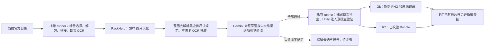

# 图片增量汉化

生产入口 `auto-track-jp-assets.yml` 的 `stage=images` 可以独立补图片积压；
日常 `translate/full` 也调用同一图片阶段。当前汉化模型为 `gpt-image-2.5`，走 OpenAI
`/v1/images/edits`；视觉验收模型为 `gemini-3.8-flash-high`，走原生 Gemini `generateContent`。
图片汉化使用 `preserve_layout` 配置读取 `configs/image-translation-prompt.txt` 通用提示词，
该模板专用于 MLTD 批量资源汉化，保留漫画、教程、横幅、贴图等各自版式；不包含指定图片的译文或角色名。
游戏 LOGO、系列品牌和游戏名称标识整体保护，包括其中的日文，不得汉化、重拼或重绘。
普通漫画标题和活动文案仍需汉化，不能把所有艺术字都当成游戏 LOGO。
目前先做有界测试，自动批量生成仍暂停，既有图片发布开启。生成和验收串行，每次启动至少间隔 30 秒。
结果规范尺寸时只允许去掉原图没有的整列黑边，剩余比例误差须在 1% 内，再缩放到原图尺寸并保留源 Alpha。
不使用 OCR 掩膜把原文贴回去，不静默更换模型。
不再执行只有 937 张固定基线的旧批处理入口，已有 937 张汉化 PNG 和对应发布成果继续保留。

2026-10-15，1077750 目录中登记的八类图片合计 4,574 个 Bundle；现有发布覆盖其中 230 个，
另有 4,344 个待增量检查。漫画 968、单格漫画 415、白板 629、贴图 207；
另有活动横幅、教程、服装销售图、标题/Logo。这是 Bundle 数量，不能直接当作未翻译图片张数。
同一个 Bundle 可以含多张 Texture2D，OCR 未发现日文也不等于已经人工证明没有日文。

每批默认选择 12 个 Bundle，优先最新漫画。六段漫画按纹理名称的数字顺序拼接，
保留每段坐标；其他登记类型按 Texture2D 处理。托管端用 Tesseract 日文 OCR 定位文字区域。
提交模型前验证 PNG SHA-256；OCR 仅用于发现可能有文字的资源，不拼入通用提示词。
新配置采用整图候选，保留源 Alpha，但不能声称画稿 RGB 逐像素一致。
视觉验收同时检查翻译完整、原意、文字重复/缺漏、人物画面、布局、英文标识和文字溢出。
只有明确 pass、七项布尔检查全真且问题列表为空才可通过。未登记类型仍属未覆盖范围。

状态记录在 `manifests/image-incremental.json`，包含官方目录身份、完整源 Bundle SHA-256、
每张新增 PNG 的 SHA、生成/验收模型、文字区域、规范尺寸记录和视觉验收报告。通过的源 PNG 写入 `images/localized/`。
同一来源已完成则跳过，来源变化重新进入队列。显式服务拒绝或错误画布比例进入待人工检查状态，不自动反复请求。
跨版本远程名变化时，先下载当前官方包验证完整 SHA-256；与既有成果或待复查记录相同便沿用决定，
不重新 OCR、解包或调用图片模型。目录指纹和大小相同不等于字节相同，不能单独作为这个证明。

模型作业不安装 UnityPy 或 OCR，只有 Pillow 和标准库；最长 150 分钟，API 预算 7,200 秒。
进度按输入队列 SHA 缓存，生成结果即时记录，重跑不重复调用已完成任务。
样本检查期间的未批准模型结果另存于 `images/candidates/`，来源与请求摘要记录在
`manifests/image-generation-cache.json`。即使 Actions 缓存过期或批次组成变化，也先按输入 PNG SHA
复用已有结果；切换到新验收配置时，旧模型/提示词的结果先复用并重新验收，不能因此重复生成。
轻量 runner 只读取来源清单，按检出提交下载需要的单张候选 PNG 并校验 SHA，不检出整个图片目录。
视觉验收绑定原图、规范后的候选、参考文字、模型及验收提示词的 SHA；报告在
`manifests/image-visual-reviews.json` 持久保存。通过、拒绝、接口失败或不确定的结果均不会偷偷重试。
图片或规则变化会产生新的验收身份，旧报告不能批准新图片。生成与验收分别缓存，验收不通过不等于重新汉化。
后续 API 调用失败时，发布阶段仍保存已成功的原始候选和报告；不完整或未通过的包不会写入安装行。
旧 Gemini 生成适配器保留以读取历史实验，活动生成配置使用 GPT；显式内容拒绝不自动重试。
阶段交接使用当前 run 的短期 Actions artifacts（输入/输出 3 天，审计 7 天），
汉化发布的 Bundle 长期存储在独立 R2 bucket；GitHub 不再作为发布 Bundle 的存储源。

包级完整结果才进入安装清单，独立重打包审计通过后上传 R2，再提交源文件和元数据。
整图视觉验收后在托管端再次 OCR 并记录残留假名数量。整图模式下，OCR 计数只作诊断，
由视觉验收区分受保护的日文游戏 LOGO 与真正漏译；不能仅因保留 LOGO 而拒绝合格结果。
旧掩膜模式仍将高置信度残留假名累计至少 3 个的整个 Bundle 转入待复查。
视觉验收未通过的结果保留在 `images/candidates/`，不会因为其中一张纹理合格就发布半个 Bundle。
2026-10-15 的首个漫画样本通过了像素/重打包校验，但仍留有日文对白，已撤出覆盖清单并保留候选和结构审计。
视觉模型也可能漏检，测试结论需要结合原图和实际问题阅读，不能仅凭模型返回一个 pass 就忽略其它检查。
发布不会替换掉历史其他图片：构建先验证兼容并复用已发布图片，新覆盖包只替换自身逻辑键。
有剩余且确实完成 Bundle 时，统一入口自动排下一批 `stage=images`；失败、零进展、显式非零 `max_items` 冒烟不循环。
R2 两版本限制仅约束发布结果，源 PNG 与文字不按版本清理。

2026-10-16 人工导入：`ex4c00959.unity3d` 使用用户上传并明确认可的汉化图。
原始上传保存在 `images/approved-inputs/`，裁剪新增左右留白、恢复 640×2193 后，按原始六段尺寸保存到 `images/localized/`。
`manifests/image-human-approvals.json` 记录原始上传、源 Bundle、每段纹理的 SHA-256、裁剪坐标及人工确认；不冒充 Gemini 自动验收。
发布 CI 在图片发布开启时调用 `scripts/materialize_human_images.py`，只对尚未发布且官方源 Bundle 全哈希相同的成果重打包，并执行独立审计。
源发生变化时留待复核，已发布成果直接复用；若另有尚未发布的图片批次，拒绝覆盖该批次，须先完成其发布。
统一构建继续合并已有图片，结果进入 R2；重打包审计作为 CI artifact 保存七天。
自动图片生成保持关闭，不调用图片模型或视觉验收模型。
