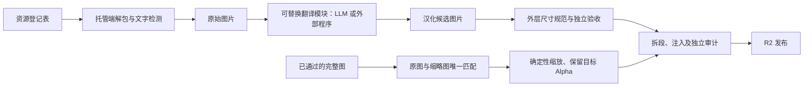

# 可替换的图片翻译模块

翻译模块只有一个调用接口：`translator.translate(input_path, output_path)`。
输入是一张图片，输出是一张 PNG 汉化候选图。调用方无需提供 Bundle、版本、纹理 ID、OCR 框、模型或验收记录。
模型地址、密钥、提示词等属于 LLM 实现的配置；外部处理程序可以完全不使用 LLM。



当前 `configs/localization-pipeline.json` 保持 `generation_enabled=false`；注册新类型和更换实现都不会自动打开图片生成。
`publication_enabled=true` 继续发布已有成果。单图 CLI 是显式调用，不受自动 CI 开关限制；本文示例不会自动执行。

## 单图调用

```powershell
python -m pipelines.image.translation --input source.png --output translated.png
```

默认读取仓库的图片策略，使用已有 LLM 适配器及通用 MLTD 提示词。
本入口不解包游戏资源、不扫描队列、不验收、不发布，也不声明输出已通过人工或视觉验收。
调用方负责缓存；输入保持不变，输出经图片解码验证后原子写入。失败时保留已有输出。
JPEG 等输入和处理程序返回的非 PNG 静态图片会规范为 PNG；多帧、过大或损坏的图片会拒绝。

## 替换成外部程序

参照 `configs/image-translator.command.example.json`，将正式策略的 `images.translator` 改为：

```json
{
  "kind": "command",
  "id": "my-image-localizer-v1",
  "argv": ["python", "tools/my_image_processor.py", "--input", "{input}", "--output", "{output}"],
  "timeout_seconds": 600
}
```

`tools/my_image_processor.py` 是示例占位路径，需要替换成实际程序。程序自己管理所需的运行依赖。
它可以在内部完成 OCR、术语翻译、擦字、修复、字体排版或调用多个服务，只需读取输入、写出一张图片并以 0 退出。
命令以 argv 数组执行，不经过 shell；路径含空格可直接使用。工作目录为仓库根目录。
输入使用隔离副本，禁止修改；退出非零、超时、未输出图片或图片无效均不会接受结果。
子程序日志不直接写入 CI，避免其输出密钥。程序需要额外配置时可在 argv 中加入自己的配置路径。

也可直接在 Python 中实现 `Translator` 的 `_run(input_path, output_path)`，或调用工厂获取现有适配器。
标准入口与外部程序都只处理图片文件；JSON 模型配置不属于待翻译图片的输入契约。

## 外层职责

- 队列、源 SHA、断点缓存和去重：`scripts/incremental_images.py`。
- 翻译实现：`pipelines/image/translation.py`。LLM 协议细节留在 `provider_config.py`，外部程序无需密钥或模型名。
- 尺寸、Alpha 和视觉验收：`scripts/image_visual_review.py`。更换翻译器不等于绕过验收。
- 缩略图派生：`scripts/image_thumbnails.py`。只复用已批准的源图，不调用翻译或验收模型。
- 纹理注入、独立审计、R2 和版本保留：原有发布阶段。

LLM API 作业与外部命令均在标准 GitHub-hosted runner 上运行；模型请求串行限速为 RPM 2。
现有来源已有生成结果时仍优先恢复，不因替换实现而自动重新翻译。候选未通过验收与需要重新生成是两件独立的事。
